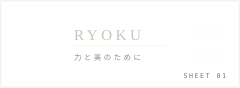
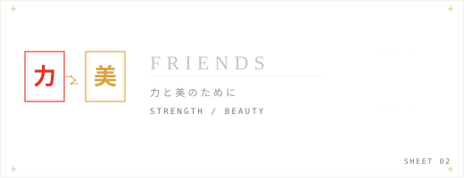
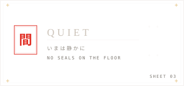

# ryoku assets

## art
# SVG Gallery

<table>
  <tr>
    <td align="center"><strong>bully</strong> </td>
    <td align="center"><strong>bully-dither</strong> </td>
    <td align="center"><strong>chikara</strong> </td>
  </tr>
  <tr>
    <td align="center"><strong>chikara-dither</strong> </td>
    <td align="center"><strong>friends-word</strong> </td>
    <td align="center"><strong>friends-word-dither</strong> </td>
  </tr>
  <tr>
    <td align="center"><strong>gate</strong> </td>
    <td align="center"><strong>gate-dither</strong> </td>
    <td align="center"><strong>hanko</strong> </td>
  </tr>
  <tr>
    <td align="center"><strong>hanko-dither</strong> </td>
    <td align="center"><strong>love</strong> </td>
    <td align="center"><strong>love-dither</strong> </td>
  </tr>
  <tr>
    <td align="center"><strong>moth</strong> </td>
    <td align="center"><strong>moth-dither</strong> </td>
    <td align="center"><strong>seal</strong> </td>
  </tr>
  <tr>
    <td align="center"><strong>seal-dither</strong> </td>
    <td align="center"><strong>sun</strong> </td>
    <td align="center"><strong>sun-dither</strong> </td>
  </tr>
  <tr>
    <td align="center"><strong>torii-mark</strong> </td>
    <td></td>
    <td></td>
  </tr>
</table>

## plates
<table>
  <tr>
    <td align="center">
      <h3>sheet 01</h3>
      
    </td>
    <td align="center">
      <h3>sheet 02/h3>
      
    </td>
    <td align="center">
      <h3>sheet 03</h3>
      
    </td>
  </tr>
</table>

## loaders

<table>
  <tr>
    <td align="center"><strong>system24</strong> </td>
    <td align="center"><strong>midnight</strong> </td>
    <td align="center"><strong>ryoku</strong> </td>
  </tr>
  <tr>
    <td align="center"><strong>Ink</strong> </td>
    <td align="center"><strong>Slashes</strong> </td>
    <td></td>
  </tr>
</table>

## rasters

<table>
  <tr>
    <td align="center"><strong>app icon</strong> </td>
    <td align="center"><strong>code (blurred)</strong> </td>
    <td align="center"><strong>settings (blurred)</strong> </td>
  </tr>
</table>

