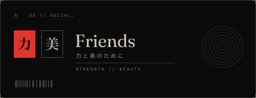
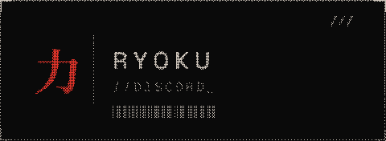
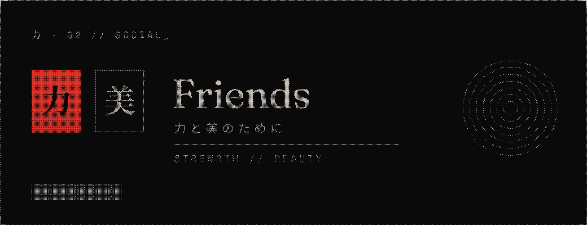
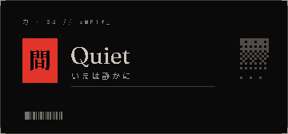
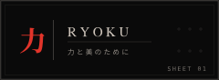
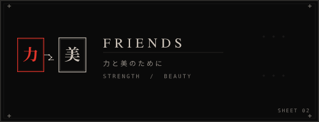
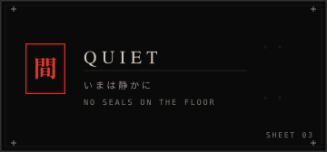

# ryoku assets

## art
# SVG Gallery

<table>
  <tr>
    <td align="center"><strong>bully</strong> </td>
    <td align="center"><strong>bully-dither</strong> </td>
    <td align="center"><strong>chikara</strong> </td>
  </tr>
  <tr>
    <td align="center"><strong>chikara-dither</strong> </td>
    <td align="center"><strong>friends-word</strong> </td>
    <td align="center"><strong>friends-word-dither</strong> </td>
  </tr>
  <tr>
    <td align="center"><strong>gate</strong> </td>
    <td align="center"><strong>gate-dither</strong> </td>
    <td align="center"><strong>hanko</strong> </td>
  </tr>
  <tr>
    <td align="center"><strong>hanko-dither</strong> </td>
    <td align="center"><strong>love</strong> </td>
    <td align="center"><strong>love-dither</strong> </td>
  </tr>
  <tr>
    <td align="center"><strong>moth</strong> </td>
    <td align="center"><strong>moth-dither</strong> </td>
    <td align="center"><strong>seal</strong> </td>
  </tr>
  <tr>
    <td align="center"><strong>seal-dither</strong> </td>
    <td align="center"><strong>sun</strong> </td>
    <td align="center"><strong>sun-dither</strong> </td>
  </tr>
  <tr>
    <td align="center"><strong>torii-mark</strong> </td>
    <td></td>
    <td></td>
  </tr>
</table>

## plates
<table>
  <tr>
    <td align="center">
      <h3>sheet 01</h3>
      
    </td>
    <td align="center">
      <h3>sheet 02</h3>
      
    </td>
    <td align="center">
      <h3>sheet 03</h3>
      
    </td>
  </tr>
</table>

## plates (current)
the plates the theme uses, shown in the default colours. the files in [`plates/`](plates) are white masks the theme colours in, these previews are in [`plates/preview/`](plates/preview).

<table>
  <tr>
    <td align="center"><strong>plate 01</strong> </td>
    <td align="center"><strong>plate 02</strong> </td>
    <td align="center"><strong>plate 03</strong> </td>
  </tr>
  <tr>
    <td align="center"><strong>plate 01 dither</strong> </td>
    <td align="center"><strong>plate 02 dither</strong> </td>
    <td align="center"><strong>plate 03 dither</strong> </td>
  </tr>
  <tr>
    <td align="center"><strong>plate 03 solid</strong> </td>
    <td align="center"><strong>plate 03 solid dither</strong> </td>
    <td></td>
  </tr>
</table>

## simple plates
plain versions of the plates, used by the calm templates through [`build/ryoku-calm.css`](../build/ryoku-calm.css).

<table>
  <tr>
    <td align="center"><strong>simple 01</strong> </td>
    <td align="center"><strong>simple 02</strong> </td>
    <td align="center"><strong>simple 03</strong> </td>
  </tr>
</table>

## loaders

<table>
  <tr>
    <td align="center"><strong>system24</strong> </td>
    <td align="center"><strong>midnight</strong> </td>
    <td align="center"><strong>ryoku</strong> </td>
  </tr>
  <tr>
    <td align="center"><strong>Ink</strong> </td>
    <td align="center"><strong>Slashes</strong> </td>
    <td></td>
  </tr>
</table>

## rasters

<table>
  <tr>
    <td align="center"><strong>app icon</strong> </td>
    <td align="center"><strong>code (blurred)</strong> </td>
    <td align="center"><strong>settings (blurred)</strong> </td>
  </tr>
</table>

